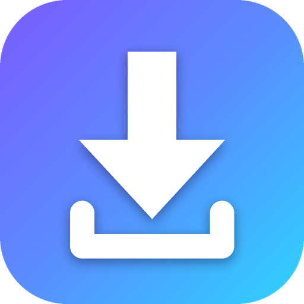
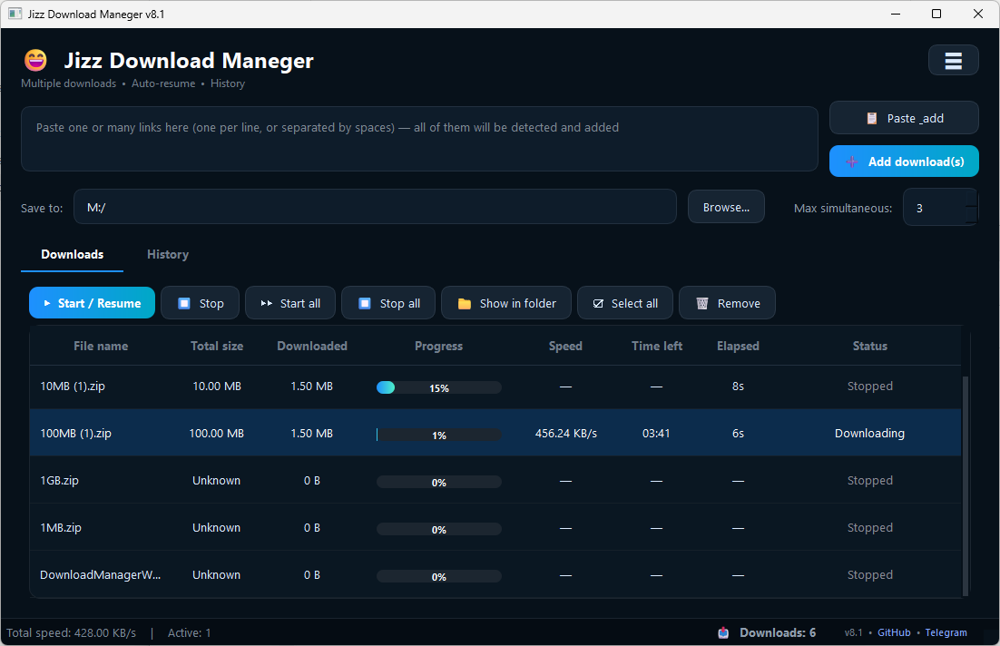

  

<h1 align="center">Jizz Download Maneger</h1>

  A fast, clean download manager for Windows. 
  <b>English</b> · <a href="#فارسی">فارسی</a>

  
  
  

  

---

## English

### What is it?

Jizz Download Maneger is a free desktop download manager for Windows. It runs several downloads at once, resumes interrupted ones, lives quietly in the system tray, and can pick up downloads from your browser.

> **Closed source.** This repository only contains the project page and license. The application is distributed as ready-to-run binaries in [Releases](../../releases).

### Features

- Several simultaneous downloads, with a queue and an adjustable limit (or one-by-one mode)
- Total size, downloaded size, progress, speed and time left for every file
- Automatic retry when the internet drops
- Resume after closing and re-opening the app (HTTP Range support)
- Start / Stop / Remove, select all
- History with "Show in folder" and "Open", like a browser
- Global speed limit
- Clipboard watch: copy a list of links and they are added automatically
- 20 colour themes (dark and light), saved between runs
- System tray: the **X** button hides the window, downloads keep running
- Optional "Start with Windows" (starts hidden in the tray)
- Browser integration for Chrome, Edge, Brave, Opera, Vivaldi and Firefox
- Portable mode: put an empty `portable.txt` next to the exe and all data stays in `./data`

### Download

Go to the [**Releases**](../../releases) page and pick one:

| File | Description |
| --- | --- |
| `JizzDownloadManeger_Setup_x64.exe` | Installer (64-bit) |
| `JizzDownloadManeger_Portable_x64.exe` | Single exe, just double-click (64-bit) |
| `JizzDownloadManeger_Portable_x64.zip` | Portable folder, settings stay inside it (64-bit) |
| `*_x86` versions | Same three files for 32-bit Windows |

### Browser integration

Browsers on Windows have no "default downloader" setting, so the app works together with a small browser extension:

1. The app listens on `127.0.0.1` only (your computer, never the network).
2. The extension hands each http/https download to the app together with the page address and cookies, so logged-in downloads work too.
3. If the app is not running, the extension does nothing and the browser downloads normally.
4. Toolbar button = capture on/off. Right-click a link → **Download with Jizz Download Maneger**.

The extension is bundled with the app: open the menu button in the app → **Browser** tab → open the extension folder, then:

- **Chrome / Edge / Brave / Opera / Vivaldi:** open `chrome://extensions` (or `edge://extensions`…), turn on *Developer mode*, click *Load unpacked* and choose the `chromium` folder.
- **Firefox:** open `about:debugging#/runtime/this-firefox`, click *Load Temporary Add-on…* and choose `firefox/manifest.json`.

### Where is my data?

- Installed version: `C:\Users\<you>\.pydownloader`
- Portable mode: the `data` folder next to the exe
- If something fails while the app is hidden, the error is written to `error.log` in that folder.

### Links

- Telegram: https://t.me/Clubapp8
- Issues and suggestions: use the [Issues](../../issues) tab

### License

Copyright © Jizz. All rights reserved. Free to use, but not open source. See [LICENSE](LICENSE).

---

## فارسی

### این برنامه چیست؟

Jizz Download Maneger یک دانلود منیجر رایگان برای ویندوز است. چند دانلود را هم‌زمان انجام می‌دهد، دانلودهای قطع‌شده را ادامه می‌دهد، بی‌سروصدا در سینی سیستم (کنار ساعت) می‌ماند و می‌تواند دانلودها را از مرورگر بگیرد.

> **سورس بسته.** این مخزن فقط شامل صفحه‌ی معرفی و مجوز است. برنامه به‌صورت فایل‌های آماده‌ی اجرا در بخش [Releases](../../releases) منتشر می‌شود.

### امکانات

- چند دانلود هم‌زمان با صف و محدودیت قابل تنظیم (یا حالت یکی‌یکی)
- نمایش حجم کل، حجم دانلودشده، درصد پیشرفت، سرعت و زمان باقی‌مانده برای هر فایل
- تلاش مجدد خودکار هنگام قطع شدن اینترنت
- ادامه‌ی دانلود بعد از بستن و باز کردن دوباره‌ی برنامه (پشتیبانی از HTTP Range)
- شروع / توقف / حذف و انتخاب همه
- تاریخچه با دکمه‌های «Show in folder» و «Open» مثل مرورگر
- محدودکننده‌ی سرعت کلی
- پایش کلیپ‌بورد: لیستی از لینک‌ها را کپی کنید، خودکار اضافه می‌شوند
- ۲۰ تم رنگی (تیره و روشن) که بین اجراها ذخیره می‌شود
- سینی سیستم: دکمه‌ی **X** فقط پنجره را مخفی می‌کند و دانلودها ادامه دارند
- گزینه‌ی «Start with Windows» (مخفی در سینی اجرا می‌شود)
- اتصال به مرورگرهای Chrome، Edge، Brave، Opera، Vivaldi و Firefox
- حالت پرتابل: یک فایل خالی با نام `portable.txt` کنار exe بگذارید تا همه‌ی اطلاعات در پوشه‌ی `data` بماند

### دانلود

به صفحه‌ی [**Releases**](../../releases) بروید و یکی از فایل‌ها را بردارید:

| فایل | توضیح |
| --- | --- |
| `JizzDownloadManeger_Setup_x64.exe` | نصب‌کننده (۶۴ بیتی) |
| `JizzDownloadManeger_Portable_x64.exe` | یک فایل exe، فقط دابل‌کلیک کنید (۶۴ بیتی) |
| `JizzDownloadManeger_Portable_x64.zip` | پوشه‌ی پرتابل، تنظیمات داخل همان پوشه می‌ماند (۶۴ بیتی) |
| نسخه‌های `*_x86` | همین سه فایل برای ویندوز ۳۲ بیتی |

### اتصال به مرورگر

مرورگرها در ویندوز گزینه‌ی «دانلودر پیش‌فرض» ندارند، برای همین برنامه با یک افزونه‌ی کوچک مرورگر کار می‌کند:

۱. برنامه فقط روی `127.0.0.1` گوش می‌دهد (فقط همین کامپیوتر، نه شبکه).
۲. افزونه هر دانلود http/https را همراه با آدرس صفحه و کوکی‌ها به برنامه می‌دهد، پس دانلودهایی که نیاز به لاگین دارند هم کار می‌کنند.
۳. اگر برنامه باز نباشد، افزونه کاری نمی‌کند و مرورگر خودش دانلود می‌کند.
۴. دکمه‌ی نوار ابزار = روشن/خاموش کردن دریافت. روی لینک راست‌کلیک کنید و **Download with Jizz Download Maneger** را بزنید.

افزونه همراه برنامه است: در برنامه دکمه‌ی منو ← تب **Browser** ← باز کردن پوشه‌ی افزونه، سپس:

- **Chrome / Edge / Brave / Opera / Vivaldi:** آدرس `chrome://extensions` (یا `edge://extensions` و…) را باز کنید، *Developer mode* را روشن کنید، روی *Load unpacked* بزنید و پوشه‌ی `chromium` را انتخاب کنید.
- **Firefox:** آدرس `about:debugging#/runtime/this-firefox` را باز کنید، روی *Load Temporary Add-on…* بزنید و فایل `firefox/manifest.json` را انتخاب کنید.

### اطلاعات من کجا ذخیره می‌شود؟

- نسخه‌ی نصبی: `C:\Users\<نام شما>\.pydownloader`
- حالت پرتابل: پوشه‌ی `data` کنار exe
- اگر برنامه‌ی مخفی خطایی بدهد، در همان پوشه در فایل `error.log` ذخیره می‌شود.

### لینک‌ها

- تلگرام: https://t.me/Clubapp8
- گزارش مشکل و پیشنهاد: از تب [Issues](../../issues) استفاده کنید

### مجوز

حق نشر © Jizz. تمام حقوق محفوظ است. استفاده رایگان است ولی سورس باز نیست. فایل [LICENSE](LICENSE) را ببینید.

